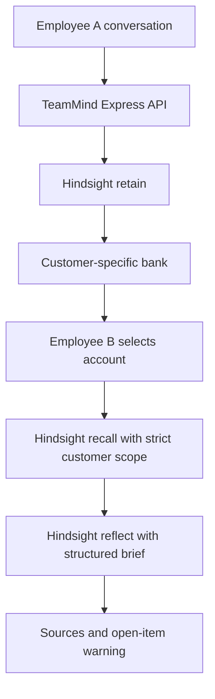

# TeamMind — Shared Customer Memory Agent

## Problem

Customer conversations are often handled by different employees over time. When the account owner changes, a session-based assistant has no access to the previous employee's conversation, so customers repeat themselves and unresolved requests can be mistaken for agreements.

## Solution

TeamMind retains customer conversations in Hindsight and retrieves relevant history for the next teammate. The central workflow is a customer-scoped memory handoff, not a general CRM or chat bot.

## Key Idea

**When the person handling a customer changes, the context doesn't.**

Each customer has an isolated Hindsight bank. Employee identity is recorded as source metadata, not used as the memory owner. Employee B can therefore retrieve Employee A's account history, while another customer's bank remains outside the retrieval path.

## Why Memory Matters

A normal chat session remembers only the current session. TeamMind writes information to persistent Hindsight memory and retrieves it in a later employee context. The brief is built from retrieved customer memories, includes their source and employee, and calls out requests or possible actions that are not confirmed.

## Hindsight Integration

- **Stored:** Full conversation content is passed to Hindsight's `retain` operation with an event timestamp, source context, conversation document ID, customer ID, employee ID, and source metadata. Hindsight extracts and indexes the memory facts.
- **Customer association:** The API accepts only the five fictional demo customer IDs. Each ID deterministically maps to its own Hindsight bank and is also written as a `customer:<id>` tag.
- **Retrieval:** The backend calls Hindsight `recall` with the customer's bank and a strict `all_strict` customer tag filter. It separately calls `reflect` with the same bank and scope to synthesize a concise, structured handoff brief. A second employee does not change either scope.
- **Trust signals:** Hindsight receives retain/reflect instructions to preserve uncertainty. The application also surfaces a deterministic warning when recalled discount facts contain request language without a recorded approval. The brief never treats a possible purchase as a commitment.
- **Persistence:** No customer history is held in a process-local memory store. The demo seed button calls Hindsight `retain` for each account; stable document IDs make repeat seeding an upsert rather than a duplicate.

Customer banks are the primary isolation boundary; strict tags are a second scope check. This prototype does not replace authentication or authorization.

## Architecture



## Demo Scenario

Rahul Sharma (`CUST-001`) likes the business analytics product but considers its ₹50,000 price high. He asks whether a 20% discount is possible and says he *may* consider buying next month. Employee A stores this interaction. Employee B takes over, requests a brief, and sees the prior discussion plus a warning that a discount was discussed but not confirmed. The possible purchase remains a possibility, not a promise.

All sample customers and conversations are fictional.

## Before vs After Memory

**Without shared memory:** Employee B asks Rahul to repeat what was discussed with a colleague.

**With TeamMind:** Employee B receives retrieved context from Employee A's interaction, including the unresolved discount request and the uncertainty around possible purchase timing.

## Tech Stack

- React 19, TypeScript, and Vite
- Express, Zod, and Node.js
- Official `@vectorize-io/hindsight-client` TypeScript SDK
- Hindsight `retain`, `recall`, and `reflect` operations
- Node's built-in test runner with `tsx`

## Setup

Prerequisites: Windows 10+, Node.js 22+, npm, Ollama, and `uv`/`uvx`. TeamMind runs Hindsight locally with embedded PostgreSQL (`pg0`) and uses Ollama for inference; no API key or Docker is required.

```powershell
npm install
Copy-Item .env.example .env
ollama pull llama3.2:1b
```

Ollama should be running at `http://localhost:11434` (the Windows Ollama app normally starts its local service). The first TeamMind API start uses `uvx` to install and launch the official Hindsight embedded daemon. Hindsight stores its local `pg0` data in its persistent user profile.

The 1B model is selected to fit a typical laptop more comfortably than the 3B variant. Local inference can be slower than hosted models; close memory-heavy applications if Ollama or Hindsight cannot load. `HINDSIGHT_LOCAL_NUM_CTX` limits the Ollama context to reduce memory use. Never commit `.env`.

## Environment Variables

| Variable | Purpose |
| --- | --- |
| `HINDSIGHT_MODE` | `local` starts the embedded daemon; set to `cloud` to opt into Hindsight Cloud |
| `HINDSIGHT_LOCAL_PORT` | Local embedded Hindsight API port; defaults to `8888` |
| `HINDSIGHT_LOCAL_MODEL` | Ollama model used by Hindsight; defaults to `llama3.2:1b` |
| `HINDSIGHT_LOCAL_NUM_CTX` | Ollama context cap; defaults to `4096` |
| `OLLAMA_BASE_URL` | Local Ollama OpenAI-compatible endpoint; defaults to `http://localhost:11434/v1` |
| `HINDSIGHT_BASE_URL` | Hindsight Cloud API URL when `HINDSIGHT_MODE=cloud` |
| `HINDSIGHT_API_KEY` | Hindsight Cloud API key when `HINDSIGHT_MODE=cloud` |
| `PORT` | TeamMind API port; defaults to `3001` |
| `FRONTEND_ORIGIN` | Allowed browser origin; defaults to Vite's `http://localhost:5173` |

Embeddings use Hindsight's local provider. The configured Ollama model handles retain and reflect; there is no separate LLM key in local mode.

## Running the Project

With Ollama running, the model pulled, and `.env` configured:

```powershell
npm run dev
```

Open `http://localhost:5173`. The Express API starts the embedded Hindsight daemon on port `8888` and runs on port `3001`; Vite proxies `/api` requests to it. First start may download the Hindsight runtime and local embedding model. `npm run build` followed by `$env:NODE_ENV="production"; npm start` serves the built UI and API from the same process on port `3001`.

Choose **Seed demo histories** to retain all five fictional conversations in Hindsight. This performs real Hindsight writes and may use the configured model. For the main handoff, use Rahul, store or seed Employee A's conversation, select Employee B, then choose **Brief me**. The **Customer memory** tab shows recalled facts with employee and source provenance.

## Testing

```powershell
npm test
npm run build
```

The API tests cover the fictional customer list, memory creation metadata, cross-employee retrieval scope, uncertainty warning, unknown customer IDs, empty conversation validation, and visible Hindsight failure handling. Test doubles are used only to verify the API contract; the application itself has no fake-memory fallback.

## Demo

See [demo/demo-script.md](demo/demo-script.md) for a timed three-minute walkthrough.

See [docs/screenshots.md](docs/screenshots.md) for the four recommended documentation captures and their expected content.

## Limitations

This is a hackathon prototype. The UI simulates Employee A and Employee B rather than authenticating them. Hindsight connection, model availability, and extraction quality affect live behavior. The warning rule is intentionally narrow and is not a general commitment-classification system. Production use would require stronger authentication and authorization, tenant isolation review, monitoring, privacy controls, retention policy, and human review of memory governance.